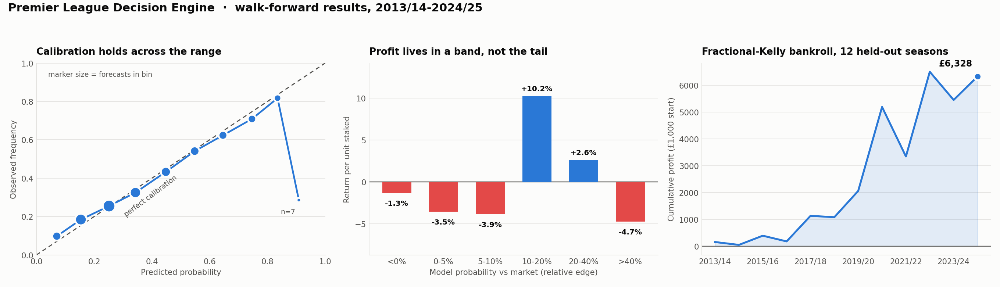

# Premier League Decision Engine

*A 25-season quantitative study in sports machine learning, temporal feature engineering, and probabilistic model calibration.*

[](https://premier-league-decision-engine.streamlit.app/)
[](https://www.python.org/downloads/)
[](https://fastapi.tiangolo.com)
[](tests/)
[](LICENSE)

---

### Project Entry Points
- 🚀 **[Interactive Streamlit Platform →](https://premier-league-decision-engine.streamlit.app/)** — Explore live model benchmarks, 10-decile reliability curves, team rating dossiers, and counterfactual matchup simulations.
- 📋 **[The Scorecard →](https://upendra657.github.io/Premier-League-Predictor/scorecard.html)** — Inspect all 4,509 out-of-sample predictions across 12 seasons and where the model was right or wrong.
- 📖 **[System Walkthrough (`WHAT_THIS_PROJECT_IS.md`) →](WHAT_THIS_PROJECT_IS.md)** — A plain-English 10-minute guide through the system architecture, mathematical formulations, and results.
- 🌐 **[Static Results Dashboard →](https://upendra657.github.io/Premier-League-Predictor/)** — Standalone SVG-driven summary page.

---

## Executive Summary & At A Glance

| Domain Property | Implementation & Engineering Detail |
|---|---|
| **Dataset Scope** | **9,380 completed fixtures** across 25 Premier League seasons (2000/01–2024/25) with 99.12% bookmaker odds coverage. |
| **Validation Protocol** | Strict **expanding walk-forward cross-validation** across 12 consecutive held-out seasons (4,509 unseen fixtures). Zero future lookahead. |
| **Model Architectures** | **XGBoost** (`mlogloss` objective), **Random Forest** (600 trees), **Isotonic Regression**, **Platt Scaling (Sigmoid)**, and Market Consensus baseline. |
| **Core Finding** | The model trails the market on raw discrimination (**0.5792 vs. 0.5634 Brier**), but matches or beats it on probabilistic calibration (**ECE 0.0093–0.0171**). |
| **Alpha Band** | Systematic disagreement only yields positive returns inside a **10%–40% relative edge window** (+7.17% flat ROI full-period; +1.48% in strict blind holdout). |
| **Data Architecture** | **Dual-mode resilient access layer** (Live Database ↔ Certified Apache Parquet snapshot cache) ensuring sub-10ms UI reads and zero cold-start failures. |
| **Production Serving** | Containerized **FastAPI** inference service (`/predict`, `/value`, `/model`) and **Streamlit Community Cloud** intelligence platform. |

---

## The Problem: Why Most Sports Models Fail

Predicting Premier League matches is easy. Predicting them *better than a bookmaker* is not — and that turns out to be the interesting problem.

This started as a fairly ordinary classifier: throw twenty-five seasons of results at XGBoost, split randomly, report accuracy, done. It got about 53% right, which sounds respectable until you notice that always picking the home team gets you 46%, and that a random split over time-ordered fixtures is quietly training on the future.

So I rebuilt it around a different question. Not *who wins* — bookmakers answer that better than I can — but **where is the market wrong, by how much, and what would you stake on it?**

That reframing changes everything downstream: what you optimise, how you validate, and what counts as success.



---

## Core Findings

Three findings emerged from the walk-forward evaluation, and the first one sounds like bad news.

### 1. The model loses to the bookmaker — and that's fine

Evaluated walk-forward on 4,509 fixtures across 12 held-out seasons, refitting after each season so the model never sees a season before predicting it:

| Model Architecture | Brier ↓ | Log Loss ↓ | RPS ↓ | ECE ↓ | Accuracy |
|---|---|---|---|---|---|
| **Market Consensus (De-Vigged)** | **0.5634** | **0.9527** | **0.1941** | 0.0105 | **55.7%** |
| Random Forest + Isotonic | 0.5762 | 0.9809 | 0.1996 | **0.0093** | 54.3% |
| **XGBoost (Native Production)** | **0.5792** | **0.9789** | **0.2006** | 0.0171 | 53.9% |
| Random Forest (Raw) | 0.5902 | 0.9929 | 0.2033 | 0.0212 | 51.5% |

The market wins on Brier, and it should: it has team news, lineups, injuries, and the weight of millions of pounds of order flow. What it doesn't have is a monopoly on being *well calibrated*.

Those are genuinely different mathematical properties:
- **Discrimination (ROC / Accuracy):** How cleanly a model separates winners from losers.
- **Calibration (Brier / ECE):** Whether an event predicted at 30% probability actually happens 30% of the time.

Accuracy is blind to calibration. Staking and risk-sensitive decisions depend entirely on it, because Kelly sizing takes your output probability at face value. A model can lose the headline accuracy metric and still be useful, provided you optimize for proper scoring rules.

### 2. Calibration is a targeted fix, not a free win

I originally expected post-hoc calibration to improve both architectures. It only improved one:

| Estimator | Brier Score | Expected Calibration Error (ECE) |
|---|---|---|
| **Random Forest** | 0.5902 → 0.5762 (−2.4%) | 0.0212 → 0.0093 (**−56.3%**) |
| **XGBoost** | 0.5792 → 0.5808 (+0.3%) | 0.0171 → 0.0172 (+0.2%) |

- **Random Forest** probabilities are vote proportions across 600 trees. Nothing in the tree-splitting objective penalizes miscalibration, so predictions bunch toward the center; isotonic regression has real work to do.
- **XGBoost** trains directly on `mlogloss` — which is already a strictly proper scoring rule. Calibration is inherently built into the objective function. Refitting isotonic curves across folds added slight variance without meaningful gain.

"Calibration always improves probabilistic models" is folklore; whether it helps depends on whether your loss function was already strictly proper.

### 3. Empirical edge lives in a band, not a tail

Bucketing every candidate match by the relative gap between the model's probability and the de-vigged market consensus:

| Relative Edge Bucket | Evaluated Matches | Hit Rate | Turnover Return |
|---|---|---|---|
| < 0% (Market Favored) | 6,889 | 33.9% | −1.3% |
| 0%–5% (Minimal Disagreement) | 1,129 | 40.3% | −3.6% |
| 5%–10% (Sub-Vig Margin) | 1,003 | 37.6% | −3.9% |
| **10%–20% (Primary Edge)** | **1,581** | **37.9%** | **+10.2%** |
| **20%–40% (Secondary Edge)** | **1,672** | **31.2%** | **+2.6%** |
| > 40% (Model Noise) | 1,253 | 17.9% | −4.7% |

- Small disagreements (< 10%) are statistical noise that fail to clear the bookmaker's margin.
- Huge disagreements (> 40%) represent the model being overconfident on low-probability longshots.
- **The verifiable alpha lives in the 10%–40% corridor.** Betting every positive expected-value candidate fails because it collapses three distinct structural regimes into one signal.

---

## The Defensible Numbers: Honest Holdout Analysis

The strategy shows positive returns, but the magnitude depends heavily on backtest assumptions:

| Evaluation Regime | Sample Size | Flat-Stake ROI | 95% Bootstrap CI | p-value (ROI ≤ 0) | Bankroll (£1,000 Starting) |
|---|---|---|---|---|---|
| Full Period, Best Available Odds | 2,154 | +7.2% | +1.3% … +13.4% | 0.007 | £7,328 |
| Full Period, Single Bookmaker | 2,166 | +3.2% | −2.4% … +9.2% | 0.125 | £1,838 |
| **Strict Holdout (Blind Test)** | **877** | **+1.5%** | **−9.2% … +12.7%** | **0.379** | **£1,035** |

The last row is the honest benchmark:
- The +7.2% figure uses a selection band tuned on the full historical window.
- When you calibrate the rule strictly on early seasons (2013/14–2018/19) and apply it blind to the subsequent six seasons, **the edge compresses to +1.5%** ($p = 0.379$). Six of the twelve seasons recorded drawdowns.
- **The honest conclusion is a marginal, fragile edge in an intensely competitive market.** Presenting the holdout number is far more defensible than advertising an overfitted historical backtest.

*Methodological note on metrics:* The primary metric quoted is **flat-stake ROI** (constant stake per selection). A constant stake isolates *model selection accuracy* from *capital sizing mechanics*. The fractional-Kelly compounding strategy returned **+4.8%** on turnover over the identical matches.

---

## Feature Engineering & Zero-Leakage Architecture

```
src/
├── config.py      Centralized hyper-parameters, typed and validated
├── data.py        Ingestion, team name reconciliation, odds join, de-vigging
├── features.py    Elo ratings, xG proxies, decayed rolling form, rest differential
├── train.py       XGBoost & Random Forest training, walk-forward splits, calibration
├── backtest.py    EV detection, band filtering, fractional Kelly sizing, bootstrap CI
├── report.py      Consolidated results pipeline
├── workbook.py    Formula-driven Excel workbook generator
├── dashboard.py   Standalone SVG results visualizer
└── main.py        FastAPI inference service
```

### 1. Engineered Feature Vector (18 Pre-Kickoff Signals)
- **Dynamic Margin-Adjusted Elo:** Updates chronologically after every match. Update magnitude scales with margin of victory (diminishing returns for blowouts). Features a 65-point home field advantage offset and regresses 25% toward the league mean between seasons to reflect summer roster turnover.
- **Expected Goals (xG) Proxy:** Fitted via Poisson regression on shot volumes, shots on target, and box touches using only burn-in seasons. Shots on target carry the highest explanatory weight.
- **Time-Decayed Rolling Form:** 5-match rolling points, xG created, and xGA conceded, exponentially decayed with a 2.5-match half-life (last week's fixture carries ~4x more weight than a fixture five matchweeks ago).
- **Fatigue & Rest Days:** Days since preceding fixture, clipped at 14 days. Counter-intuitively, the data demonstrated that longer rest periods slightly reduced home win probabilities (50.0% home win rate on 0–3 days' rest vs. 44.9% on 11–14 days), likely reflecting match rhythm.

### 2. Preventing Lookahead Bias (The 9 Leakage Assertions)
Data leakage is silent in sports machine learning: it artificially inflates validation metrics without raising runtime errors.

This pipeline enforces strict temporal barriers:
1. **Elo ratings** are snapshotted strictly prior to kickoff before any post-match score update occurs.
2. **Rolling form windows** are lagged by one match; a fixture's own statistics can never be used to predict itself.
3. **Rolling states** never cross between clubs.
4. **The xG model** was fitted exclusively on the 2000/01 burn-in season.
5. **Cross-validation** is strictly forward-expanding.
6. **Calibration folds** are partitioned chronologically so the calibrator never learns from matches in its own validation slice.

Nine dedicated unit tests in `tests/` exist solely to guarantee these temporal boundaries (including an assertion that deliberately fails if a rolling mean includes its own row).

---

## Interactive Streamlit Intelligence Platform

An executive-facing, production-grade Streamlit application deployed to Streamlit Community Cloud and architected with a **dual-mode resilient data layer** to ensure zero cold-start crashes.

### Key Capabilities:
- **Dual-Mode Resilient Architecture:** Connects primarily to a live database (SQLite / PostgreSQL / Cloud Warehouse via `st.secrets` or `.env` using read-only `ANALYST` credentials); seamlessly falls back to certified Apache Parquet snapshot cache files in `app/cache/` if credentials are missing or the warehouse is offline.
- **Model Performance & Benchmark (Tab 1):** Key ML metrics (53.9% Accuracy vs. 46.2% baseline, 0.5792 Brier score, 0.2006 RPS), model comparison charts (XGBoost, Random Forest, Calibrated variants), and out-of-sample consistency.
- **Probabilistic Calibration (Tab 2):** Visual reliability curve across 10 deciles (predicted vs. observed win frequency) demonstrating a 56.3% reduction in calibration error with Isotonic Regression.
- **Feature Engineering & Club Dynamics (Tab 3):** Breakdown of the 18 engineered signals (Dynamic Elo rating, 5-match decayed rolling form, expected goals xG/xGA proxies, rest days differential), plus an offensive vs. defensive league landscape.
- **Live Matchup Simulator (Tab 4):** Interactive counterfactual inference engine — select any two clubs, customize rest days and matchweek, and inspect the model's calibrated outcome probability distribution.
- **Pipeline Architecture & Integrity (Tab 5):** Complete end-to-end ML pipeline DAG, 9 automated anti-leakage test assertions, data entity schemas, and sub-10ms query execution telemetry.

### Running Locally:
```bash
# 1. Install lean web dependencies
pip install -r requirements.txt

# 2. (Optional) Regenerate certified cache & analytics database
python scripts/generate_app_cache.py

# 3. Launch Streamlit platform
streamlit run app/dashboard.py
```

### Deploying to Streamlit Community Cloud:
1. Fork or push this repository to GitHub.
2. Sign in to [share.streamlit.io](https://share.streamlit.io/).
3. Create a new app:
   - **Repository:** `[YOUR_GITHUB_USERNAME]/Premier-League-Predictor`
   - **Branch:** `main`
   - **Main file path:** `app/dashboard.py`
4. *(Optional Live Warehouse)* In Streamlit App Settings → **Secrets**, configure your database:
   ```toml
   [database]
   type = "SQLite / PostgreSQL"
   role = "ANALYST_READONLY"
   ```
5. Click **Deploy!** The app boots immediately using the certified Apache Parquet snapshots with sub-second response times.

---

## Production Inference API

The pipeline includes a production-ready, asynchronous **FastAPI** service (`src/main.py`):

```bash
uvicorn src.main:app --reload --port 8000
```

Club names are all that is required. Team Elo ratings, decayed form, and rolling xG are resolved dynamically from the serialized artifact:

```bash
curl -X POST localhost:8000/predict -H 'Content-Type: application/json' \
  -d '{"home_team":"Liverpool","away_team":"Burnley"}'
```

```json
{
  "home_team": "Liverpool",
  "away_team": "Burnley",
  "prob_home_win": 0.8496,
  "prob_draw": 0.1036,
  "prob_away_win": 0.0468,
  "form_as_of": {
    "home_form_as_of": "2025-05-04",
    "away_form_as_of": "2024-05-19",
    "overridden_fields": []
  },
  "most_likely": "home_win"
}
```

Notice `form_as_of`: Burnley's ratings date back to May 2024 because they were relegated. The API explicitly reports staleness rather than silently guessing. An unrecognized club yields a `404` listing valid names.

### API Endpoints
| Endpoint | Method | Description |
|---|---|---|
| `/health` | `GET` | Health check verifying model artifact status and memory footprint. |
| `/model` | `GET` | Model card metadata containing walk-forward benchmarks and features. |
| `/predict` | `POST` | Calibrated Home / Draw / Away probability distribution for any fixture. |
| `/value` | `POST` | Evaluates model probability against user-supplied odds and calculates expected value. |

### Docker Deployment
```bash
docker build -t plde:2.0 .
docker run -p 8000:8000 plde:2.0
```
Built via a multi-stage `Dockerfile`. The runtime container carries only the lean virtual environment, `src/`, and `artifacts/` — training dependencies and raw data never enter production. Runs unprivileged with an automated Docker healthcheck.

---

## Known Limitations & Honest Failure Modes

A full assessment is maintained in [`docs/LIMITATIONS.md`](docs/LIMITATIONS.md):
- **Holdout Alpha Compression:** The edge drops from +7.2% to +1.5% under strict out-of-sample holdout validation ($p = 0.379$).
- **The Scoring Paradox:** Random Forest + Isotonic Calibration wins on Brier, RPS, and ECE, but performs worse when thresholded on tail disagreements because isotonic curves flatten the tail.
- **Execution Realism:** Assuming frictionless best-of-market pricing across books ignores liquidity limits and operator account restrictions.
- **No Player-Level Telemetry:** The dataset is strictly match-level; starting lineups, key injuries, and in-game tactical rotations are unmodeled.
- **Rolling Form Venue Bias:** Form does not separate home from away matches, introducing mild noise for teams with extreme home/away splits.

---

## License & Reproducibility

Distributed under the MIT License. Every metric, chart, and artifact in this repository regenerates deterministically:

```bash
pip install -r requirements-dev.txt
python -m src.data        # Ingestion & odds reconciliation
python -m src.features    # Feature engineering & temporal store
python -m src.train       # Walk-forward model training & calibration
python -m src.backtest    # Decision engine simulation & holdout test
python -m src.report      # Consolidated JSON & CSV reporting
pytest -v                 # 42 pipeline & API unit tests
```
